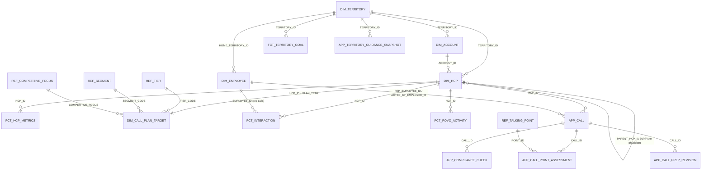

# POVO AI Guidance: Databricks

This folder holds the Delta schema, the dummy-data seeder and the scripts that deploy, load and check them.
The schema is the contract in [docs/ARCHITECTURE.md §4](../docs/ARCHITECTURE.md). Table names, column names, types and codes follow it exactly.

```
databricks/
  ddl/      00_catalog_schemas.sql  01_bronze_tables.sql  02_app_tables.sql  03_grants.sql
  seed/     generate_seed_data.py   content/*.json (owned by the backend)   output/ (generated, gitignored)
  scripts/  deploy_schema.py  load_seed_data.py  check_databricks.py  _common.py
  tests/    test_seed_data.py
```

The DDL uses the placeholders `${catalog}`, `${bronze_schema}`, `${app_schema}` and `${app_principal}`. The scripts substitute them. To run a file by hand in the SQL editor, replace them first.

## Tables

### `bronze`: reference data

The app only reads these tables. The seeder regenerates them.

| Table | What it holds | Rows (seed) |
|---|---|---|
| `DIM_TERRITORY` | The 8 Northeast territories (`NE-POR`, `NE-BOS`, `NE-HFD`, `NE-PVD`, `NE-MAN`, `NE-BTV`, `NE-WOR`, `NE-SPR`) | 8 |
| `DIM_EMPLOYEE` | One rep per territory plus 2 managers. `HOME_TERRITORY_ID` scopes every query. | 10 |
| `DIM_ACCOUNT` | 6–7 practices per territory, plus 2 claims-only sites with no affiliated HCP | 66 |
| `DIM_HCP` | 142 targets per territory: about 52 physicians (MD/DO), each with 0–2 NP/PA (`PARENT_HCP_ID`) | 1,136 |
| `FCT_HCP_METRICS` | HS volume, visits, JAK, POVO and IncyteCARES patients per HCP, one snapshot at the as-of date | 1,136 |
| `DIM_CALL_PLAN_TARGET` | Decile, tier, segment, competitive focus, in-plan flag and HS rank per target | 1,136 |
| `REF_TIER` / `REF_SEGMENT` / `REF_COMPETITIVE_FOCUS` | Lookups with labels and colours from the POC | 3 / 3 / 5 |
| `FCT_INTERACTION` | Rep calls (`rep`) and other teams' touches (`adfa`, `opz`, `msl`, `spkr`, `pr`) | ~11k |
| `FCT_POVO_ACTIVITY` | Patient funnel events: `PEF` → `NRX` → `NEW_PATIENT` (the first paid script), keyed by an opaque `PATIENT_KEY` | ~3k |
| `FCT_TERRITORY_GOAL` | Monthly goals for `NEW_PATIENTS`, `PEF` (×1.4) and `NRX` (×1.25), full year | 288 |
| `REF_US_HOLIDAY` | The POC company holidays for the as-of year and the next | 16 |
| `REF_KPI_PARAMETER` | Rates behind the Total on POVO split (`PAID_PERSISTENCE`, `PENDING_ON_THERAPY`, `BRIDGE_SHARE`); dummy values until the client supplies real ones | 3 |
| `REF_TALKING_POINT` / `REF_OBJECTION_RULE` / `REF_COMPLIANCE_RULE` | MLR-approved content, copied unchanged from `seed/content/*.json` | per content |
| `REF_COMPLIANCE_TEXT` | The compliance rewrite wording, copied unchanged from `seed/content/compliance_texts.json` | 12 |

### `app`: tables the app writes

`APP_CALL`, `APP_CALL_POINT_ASSESSMENT`, `APP_COMPLIANCE_CHECK`, `APP_CALL_PREP_REVISION`, `APP_TERRITORY_GUIDANCE_SNAPSHOT`, `APP_AI_CACHE`, `APP_AUDIT_LOG` and `APP_JOB_RUN`.
Their logical keys are in the table comments, and the backend upserts with `MERGE`. The seed loader never touches them.

### Relationships

Delta does not enforce keys, so these relationships are logical. The tests check them on the generated data.



## How the dummy data is modelled

The numbers come from the POC (`POVO_AI_Guidance_Step3_37.html`) and [spec §8](../docs/POC_FUNCTIONAL_SPEC.md).

- **Targets.** Each territory has 142 targets, split by decile like the POC (1/2/4/5/8/10/13/19/21/59, each within ±15%). Portland uses exactly the POC split.
  - HS volumes follow the POC averages per decile.
  - `HS_RANK` ranks targets by HS volume within the territory. Deciles are assigned top-down in the same order.
- **Names.** Portland reuses the POC names: Winters (D10, rank 1), Sprague, Berg and the others, with their NPs and PAs.
  - Boston, Hartford and Providence reuse the POC impersonation datasets.
  - Every other name comes from a pool. Last names are unique within a territory.
- **Employees.**
  - Vince Turano (`vturano`, `p250488`) is the Portland rep and the dev default user.
  - Dana Whitaker (`p250611` / `3418`) covers Hartford and Luis Ortega (`p250702` / `3526`) covers Providence.
  - The managers are Barbara Drake (`p250544` / `3351` / `bdrake`, home Boston) and Raymond Sutherland (`p250563` / `3372`, home Worcester).
- **Goals and actuals.**
  - Goals use the POC monthly shape `[8..19]`, scaled for each territory.
  - Actual new patients track the goal with a performance factor for each territory. Boston, Providence, Manchester and Worcester are On Track. Portland (0.88, as in the POC), Hartford, Burlington and Springfield are At Risk.
  - The current month is pro-rated by working days.
- **Writers.**
  - Each territory has about 44 writers, about 62% of them JAK users. They are spread over the deciles like the POC.
  - The month each writer first writes follows the POC `buildSeg` weights, so the new-writers chart looks like the POC.
  - `POVO_PATIENTS` always equals the HCP's number of `NEW_PATIENT` events.
  - Every new patient has a `PEF` and an `NRX`. Pending patients bring the totals to PEF ≈ 1.36× and NRx ≈ 1.2× new patients.
- **Rep calls.**
  - The number of calls for each tier is targets × calls/yr × elapsed working year × attainment (0.94 / 0.82 / 0.68).
  - The share of each tier that gets reached is set by the reach factor (0.92 / 0.83 / 0.64). The rest are never called.
  - 3–5 Super High or Medium targets have had no call for 22–50 days. The other Super High and Medium targets were called within the last 20 days.
- **Other teams.** Every physician gets 4–6 interactions from other teams. Each physician attends at least one speaker program, and programs are shared evenings.
- **Dates.** Nothing is dated after `--as-of`. Activity starts on January 1 of the as-of year.

The output is deterministic for a given `--seed` and `--as-of`. Each concern has its own random stream, so changing the as-of date never reshuffles the HCP universe.

## Running it

```bash
# one-off setup (from the repo root)
python -m venv databricks/.venv
databricks/.venv/Scripts/python -m pip install -r databricks/requirements.txt   # Windows; bin/python elsewhere

# 1. generate CSVs (pure standard library; tzdata only needed for the default --as-of on Windows)
python databricks/seed/generate_seed_data.py                         # as-of = today, America/New_York
python databricks/seed/generate_seed_data.py --as-of 2026-10-13 --seed 20260930 --out databricks/seed/output

# 2. create catalog, schemas and tables (idempotent)
python databricks/scripts/deploy_schema.py --dry-run                 # print the SQL
python databricks/scripts/deploy_schema.py                           # or --skip-catalog if admins pre-created it

# 3. load bronze (TRUNCATE + batched parameterised INSERT; app tables untouched)
python databricks/scripts/load_seed_data.py --dry-run
python databricks/scripts/load_seed_data.py                          # --tables DIM_HCP,FCT_INTERACTION to limit

# 4. preflight
python databricks/scripts/check_databricks.py --write-test

# tests
python -m pytest databricks/tests -q
```

Configuration is read from the environment first, then from `backend/.env` and `backend/.env.local`. A real environment variable always wins. You can also pass `--env-file`.

| Variable | Default | |
|---|---|---|
| `DATABRICKS_HOST` | — | Workspace host, with or without `https://` |
| `DATABRICKS_TOKEN` | — | Personal access token |
| `DATABRICKS_WAREHOUSE_ID` | — | The script builds the HTTP path `/sql/1.0/warehouses/<id>` |
| `DATABRICKS_CATALOG` | `povo_ai_guidance` | |
| `DATABRICKS_SCHEMA` | `bronze` | |
| `DATABRICKS_APP_SCHEMA` | `app` | |
| `DATABRICKS_APP_PRINCIPAL` | — | Only needed for `--with-grants` |

## Grants

The app principal gets `SELECT` on `bronze` and `SELECT` + `MODIFY` on `app`, plus `USE CATALOG` and `USE SCHEMA` ([ddl/03_grants.sql](ddl/03_grants.sql)). There are two ways to apply them:

```bash
python databricks/scripts/deploy_schema.py --skip-catalog --with-grants --app-principal <user, group or SP application id>
```

Or give the file to a workspace admin with the placeholders filled in. Nothing grants the app any write access to `bronze`.

## Re-seeding

1. Run `generate_seed_data.py`, with a new `--as-of` if you want to move "today".
2. Run `load_seed_data.py`. Every bronze table is truncated and reloaded, and the row counts are verified against the CSVs. `APP_*` data is kept.
3. Run `check_databricks.py`. It compares the row counts with `seed/output/_manifest.json`.

Local mode (`DATA_SOURCE=local`) needs no step 2. The backend reloads the bronze tables from `seed/output/*.csv` into DuckDB at startup.

The content tables come from `seed/content/*.json`, which the backend owns. If a file is missing, the generator warns and skips that CSV.

**Loading speed.** Databricks caps a statement at 256 parameters, so `FCT_INTERACTION` loads in about 450 batches, which takes a few minutes on a warm warehouse.
